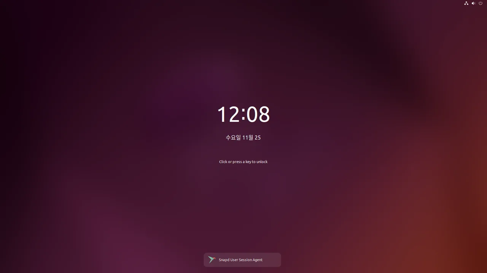
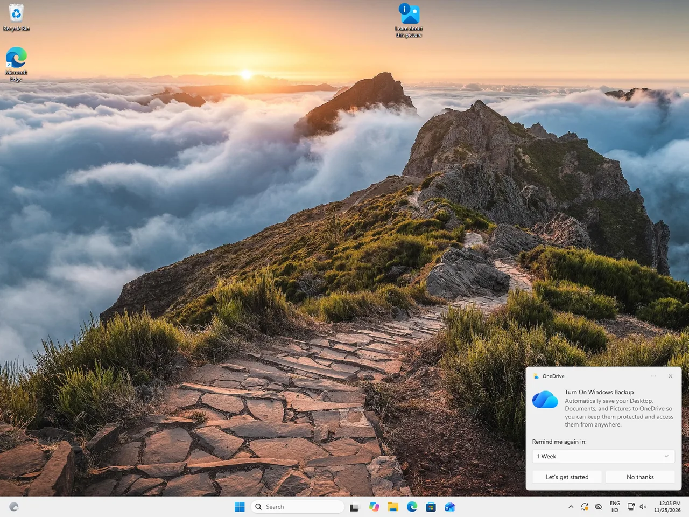
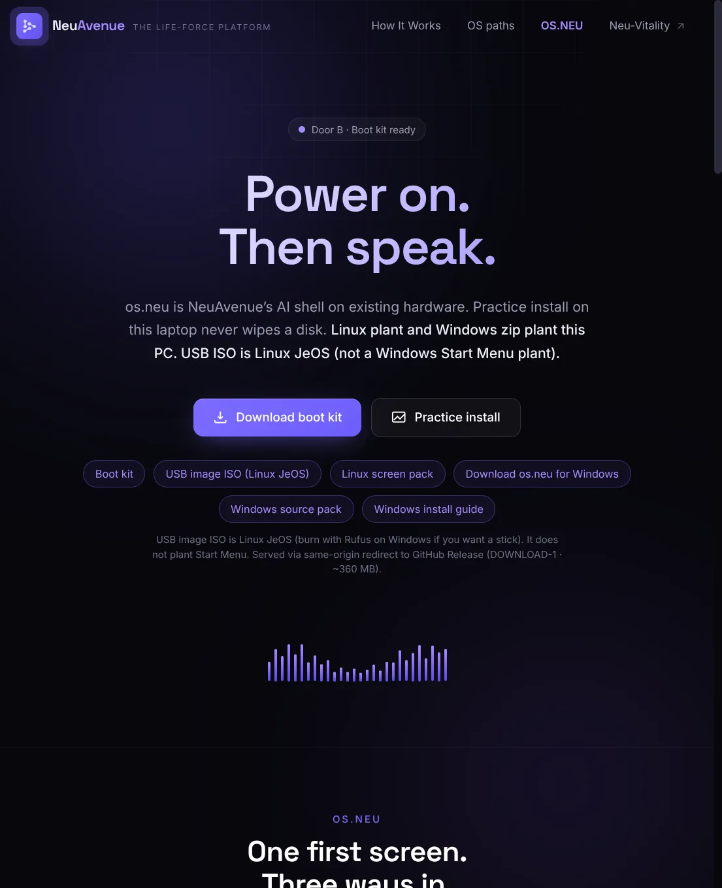
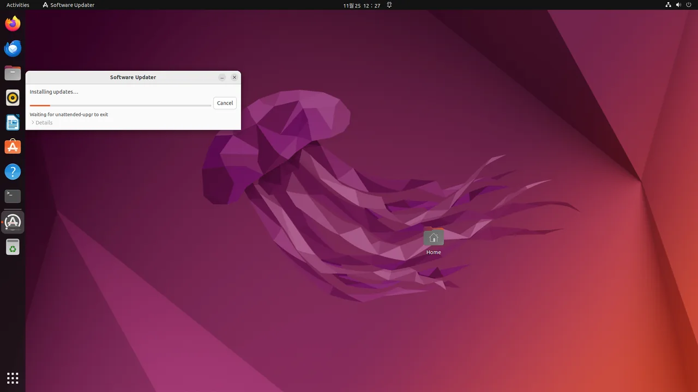
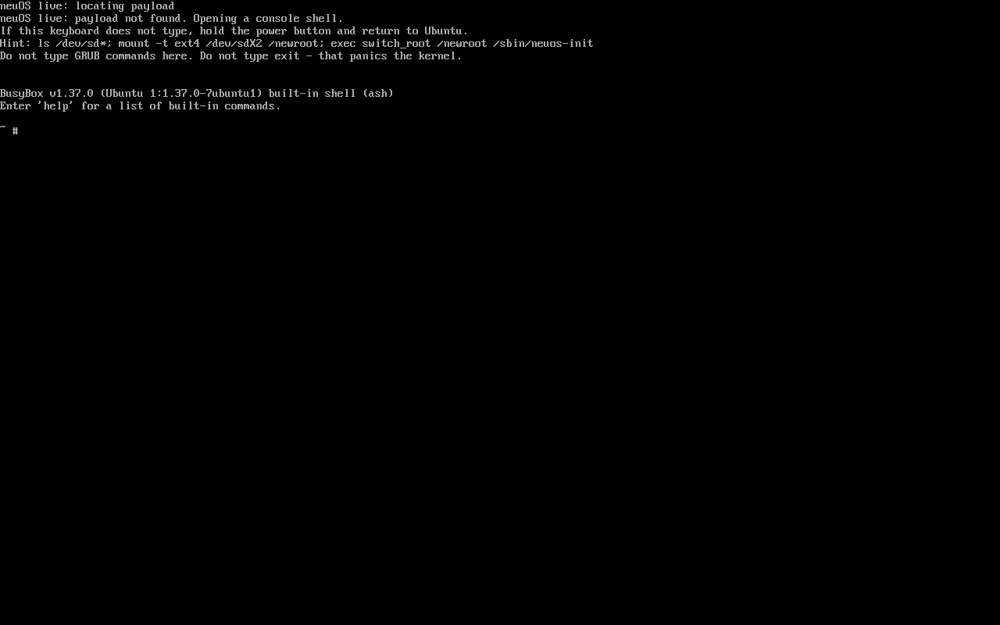

# USB from start to finish — with real screens

This page is for **anyone**: middle school, high school, university, parents, teachers.  
It shows the **same path a first customer walks**: open a computer → open the website → pick the USB file → put it on a stick → restart → see what appears.

You do **not** need to erase your school PC’s Windows or Ubuntu. USB is a **separate door**.

Full manual: [manual.en.md](./manual.en.md) · Home tour: [home-screen-guide.md](./home-screen-guide.md) · Safe Try it: [try-it-and-plant-guide.md](./try-it-and-plant-guide.md)

---

## Big idea in one breath

1. **Try it** = use os.neuavenue.com in a browser. Your disk stays as it is.  
2. **Plant** = install os.neu as an app on this PC (Start Menu / Applications). Still **no** full-disk wipe.  
3. **USB** = boot a stick and see a dark text screen first. Best path today: **Boot kit** + Linux `make-usb`. A plain ISO burn can stop early (see step 9).

---

## Step 1 — Turn on a computer

You can use a real PC or a practice virtual machine.

**Linux example (lock screen)**



*Unlock the PC so you can open a browser.*

**Windows example (desktop)**



*You are on the normal Windows desktop. That is fine.*

---

## Step 2 — Open the welcome page

In the browser go to: **https://os.neuavenue.com/welcome/**



*Look for “Door B · Boot kit ready” and the line that says USB image ISO is **Linux JeOS** (burn with Rufus on Windows if you want a stick).*

---

## Step 3 — Press the right button (easy rule)

| Press this for USB | Do **not** mix this up with USB |
|--------------------|----------------------------------|
| **USB image ISO (Linux JeOS)** | **Download os.neu for Windows** (= Windows Setup app) |
| **Download boot kit** / Boot kit | **Linux screen pack** (= plant on Linux PC) |

Same image for Windows and Linux. Only the **burn tool** changes (Rufus / Etcher / make-usb).

---

## Step 4 — Download the file

- ISO: https://os.neuavenue.com/downloads/neuos-live.iso (~360 MB)  
- Boot kit (recommended for a full console): https://os.neuavenue.com/downloads/neuos-boot-kit.tar.gz  
- Rufus (Windows burn tool): https://rufus.ie/  
- Etcher (easy burn on many PCs): https://etcher.balena.io/

---

## Step 5 — Plug in the USB stick

Use a stick that is **empty** or that you are allowed to erase.  
Never choose the disk that holds your homework, Windows `C:`, or Linux `/`.



*The stick is connected. Your normal desktop can stay open while you burn.*

---

## Step 6 — Burn the stick

**Windows:** open Rufus → pick **only** your USB → choose `neuos-live.iso` → Start → wait → safely eject.  
**Linux (easy):** balenaEtcher → pick the ISO → pick **only** the stick → Flash.  
**Linux (full console path):** unpack the **boot kit**, run `make-usb.sh` on the stick you listed (see [usb-console-guide.md](./usb-console-guide.md)). Prefer this if you want `[os.neu] >`.

---

## Step 7 — Same stick for both OS families

One burned stick can be tried on Windows PCs and Linux PCs.  
You do not need two different ISOs.

---

## Step 8 — Restart and open the boot menu

1. Leave the stick plugged in. Save your work.  
2. Restart. At the maker logo press **F8 / F12 / Esc** (PC brand differs).  
3. Choose **UEFI: … USB …**. Do not pick the internal Windows/Ubuntu disk.  
4. You should see a **boot menu** for neuOS (a short countdown is normal).


*Early boot screen. The menu can count down by itself.*

---

## Step 9 — What “success” looks like (and what to do if it stops)

**Success you want:** a dark console that says:

```text
[os.neu] >
```

**If you see this instead:**



*Message like “neuOS live: payload not found” and a BusyBox `#` prompt.*

**What it means in plain words:** the stick started, but the main os.neu “payload” was not found.  
A plain ISO copy often misses the full `NEUOS-ROOT` layout. That is a product path issue — **your PC’s hard disk was not wiped**.

**Safe next steps:**

1. Hold the power button to turn off.  
2. Unplug the USB. Turn on again → your normal Windows/Ubuntu returns.  
3. Prefer the **Boot kit** + Linux `make-usb` path, or ask for an updated ISO that finds the payload by itself.  
4. Do **not** type `exit` on that BusyBox screen (it can panic the kernel).

---

## Remember

- Website Try it ≠ USB boot ≠ Windows Setup. Three doors.  
- Never burn the disk that holds `/` or `C:`.  
- If anything feels wrong: power off, unplug USB, power on.

**Filed for docs.neuavenue.com · first-customer USB walk · 2026-11-25**
